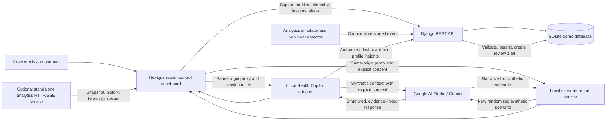

# Orbital Health Copilot

> **NASA Space Apps Challenge 2026 — Challenge #5: Create Software for Monitoring Astronaut Health During Space Missions**

Orbital Health Copilot is a prototype mission-control system for exploring astronaut health telemetry during long-duration missions. It combines a live dashboard, synthetic telemetry simulation, anomaly review, profile-level trend reports, and AI-assisted interfaces.

The project is designed for demonstrations and software development. Its measurements and models are synthetic and are **not medically validated**. It is not a medical device, diagnostic tool, or replacement for mission medical protocols.

## At a glance

- **Mission dashboard:** a Next.js interface for mission status, signals, reviews, timeline, reports, and Health Copilot.
- **Authenticated API and storage:** a Django REST Framework backend that validates and stores versioned telemetry, serves profile history, and manages review alerts.
- **Analytics:** a Python simulator and nonlinear event-level anomaly detector, also available as a standalone local HTTP/SSE service.
- **Exploratory profile trends:** per-feature XGBoost forecasts based on a crew profile's own prior measurements.
- **AI-assisted tools:** separate local adapters for evidence-grounded chat and reports generated from new synthetic scenarios.

## Architecture



### Request and data flow

1. The dashboard authenticates with the Django API and selects a crew profile. Its API token is held in the browser session, not in a URL or persistent local storage.
2. The simulator creates synthetic measurements, evaluates each event against a synthetic baseline, and submits the canonical event contract to Django. The backend validates and persists accepted events and may create review alerts.
3. The dashboard reads persisted measurements, profile history, insights, and alerts from Django. Data-quality indicators remain separate from anomaly analysis; missing or low-quality values are not represented as normal readings.
4. Health Copilot obtains the selected profile's authorized dashboard and insights through a local adapter. After explicit consent, it sends synthetic profile context and the question to Google AI Studio. The Gemini key remains server-side.
5. Daily Reports uses a different service and generates a new randomized synthetic scenario. It does not analyze saved profile telemetry. The frontend asks for explicit consent before sending the generated scenario to Google AI Studio.

The integrated simulator is the standard demo path. The standalone analytics HTTP/SSE service is optional and can be used by a local client that needs a live stream.

## Repository structure

```text
.
├── analytics/              # Synthetic telemetry, event contract, detector, forecaster, HTTP/SSE service
│   ├── contracts.py        # Canonical feature definitions and vector ordering
│   ├── detector.py         # Nonlinear event-level anomaly analysis
│   ├── simulator.py        # Repeatable synthetic scenarios
│   ├── trend_forecaster.py # Per-profile, per-feature trend forecasting
│   ├── server.py           # Optional standalone local API and SSE stream
│   └── tests/              # Analytics and forecast tests
├── backend/                # Django REST Framework API and SQLite persistence
│   ├── api/                # Models, validation, permissions, serializers, views, and commands
│   └── core/               # Django project configuration and URL routing
├── chatbot/                # Local Gemini adapter for evidence-grounded Health Copilot
├── frontend/
│   └── my-hub/             # Next.js mission-control web application
│       └── src/app/        # Dashboard pages, chat, report workspace, and same-origin API routes
└── report/                 # Local FastAPI service for randomized synthetic scenario reports
```

Each module has its own README with detailed configuration, API contracts, limitations, and focused checks:

- [Backend: setup, authentication, API, and retention](./backend/README.md)
- [Frontend: mission workspaces and local demo](./frontend/my-hub/README.md)
- [Analytics: telemetry contract, detector, simulator, and forecasts](./analytics/README.md)
- [Health Copilot: Gemini adapter, evidence flow, and safeguards](./chatbot/README.md)
- [Daily Reports: synthetic scenario service and API](./report/README.md)

## Run the end-to-end demo

The core dashboard demo needs Python, Node.js/npm, and Windows PowerShell. These commands are run from the repository root. Choose a private local password; the example is a placeholder, not a built-in credential.

### 1. Install dependencies and initialize the backend

```powershell
py -m venv backend\.venv
.\backend\.venv\Scripts\python.exe -m pip install -r backend\requirements.txt
Set-Location frontend\my-hub
npm ci
Set-Location ..\..
.\backend\.venv\Scripts\python.exe backend\manage.py migrate
.\backend\.venv\Scripts\python.exe backend\manage.py setup_demo --username crew --password 'REPLACE-WITH-A-LOCAL-PASSWORD'
```

### 2. Start the Django API

In the first terminal, from the repository root:

```powershell
.\backend\.venv\Scripts\python.exe backend\manage.py runserver 127.0.0.1:8000
```

### 3. Start the synthetic telemetry pipeline

In a second terminal, from the repository root:

```powershell
.\backend\.venv\Scripts\python.exe backend\manage.py run_mission_simulator --profile-id crew-01 --scenario demo --interval 1 --seed 42
```

The repeatable `demo` sequence includes baseline readings, nonlinear interactions, sensor artifacts, gradual drift, signal loss, and a radiation event. Use `--scenario normal` for a stable baseline, `--max-events 10` for a finite run, or Ctrl+C to stop.

### 4. Start the dashboard

In a third terminal:

```powershell
Set-Location frontend\my-hub
npm run dev
```

Open [http://localhost:3000](http://localhost:3000), sign in with the account created above, and select the `crew-01` profile. The dashboard reads persisted backend data; it does not substitute hard-coded readings for the live data flow.

For Health Copilot and Daily Reports, follow the setup in their module READMEs. Both services are optional. They require separate Google AI Studio configuration and explicit consent before synthetic context is sent to Google.

## Services and interfaces

| Component | Local address | Role |
|---|---|---|
| Next.js dashboard | `http://localhost:3000` | Mission workspaces and same-origin proxy routes |
| Django REST API | `http://127.0.0.1:8000` | Authentication, profiles, persisted telemetry, insights, alerts |
| Analytics HTTP/SSE service (optional) | `http://127.0.0.1:8765` | Standalone simulator snapshot, history, and live stream |
| Health Copilot adapter (optional) | `http://127.0.0.1:8766` | Local, server-side Gemini integration for evidence-grounded chat |
| Daily Report service (optional) | `http://127.0.0.1:8001` | Reports for newly generated synthetic scenarios |

The Django API is the persistence and authorization boundary for the integrated demo. Analytics events use the shared schema in [analytics/event.schema.json](./analytics/event.schema.json). The backend exposes authenticated, versioned endpoints and interactive API documentation at `/api/docs/` while it is running.

## Analytical interpretation and safety

- The simulator uses synthetic values only. Scenario labels are for testing and are not clinical labels.
- The event detector compares a measurement vector with a limited synthetic baseline. Its score is an empirical tail rank, **not a probability**, diagnosis, confidence estimate, or universal risk measure.
- Anomaly contributors describe patterns used by a model; they do not establish cause. Personal baselines and XGBoost forecasts are exploratory, not medical thresholds or clinical predictions.
- Missing and low-quality signals must remain visibly unknown or degraded, not be treated as normal.
- Health Copilot blocks real telemetry from being sent to Gemini. Use synthetic profiles for demonstrations; explicit consent is required before external AI processing.
- Keep local services bound to loopback. Do not expose demo services publicly without deliberate authentication, authorization, privacy, and deployment controls.
- For serious or sudden symptoms, follow the mission emergency protocol and contact a qualified medical professional.

## Checks

Run focused module checks from the repository root:

```powershell
.\backend\.venv\Scripts\python.exe backend\manage.py test api.tests -v 2
.\backend\.venv\Scripts\python.exe -m unittest discover -s analytics\tests -v
python -m unittest chatbot.tests.test_server -v
```

Frontend checks, from `frontend\my-hub`:

```powershell
npm run lint
npx tsc --noEmit
npm run build
```

These checks validate software behavior on synthetic data. They do not constitute medical or operational validation.
